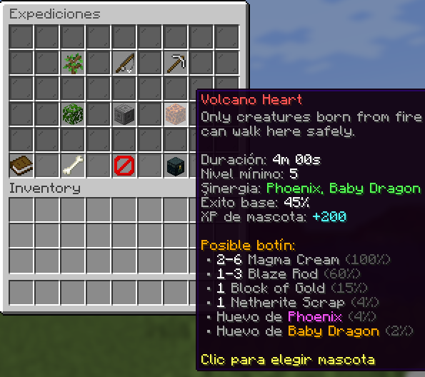
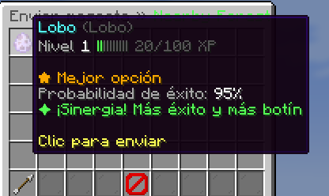
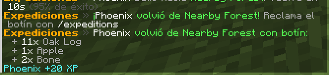

# PetExpeditions

Send your tamed **wolves, cats and parrots** on timed expeditions. They come back with loot, gain XP and level up.
Every expedition has a **synergy** pet type that gets more success and more loot, so choosing the right pet matters.

Made for **Paper 1.21 / 1.21.1** (Purpur works too).

| Expeditions board | Choosing a pet | Loot |
|---|---|---|
|  |  |  |

## Features

- **Register pets in-game**: Shift + right-click your own tamed wolf, cat or parrot with an empty hand (twice, to confirm). The pet leaves the world and joins your expedition team. You can take it out again at any time.
- **Expeditions board** (`/expeditions`): every expedition shows duration, minimum level, synergy type, base success and the possible loot.
- **Smart pet picker**: your pets are sorted from best to worst for that expedition, with the real success chance and a **★ Best choice** tag.
- **Levels and XP**: every expedition gives pet XP (even failed ones give a little). Each level adds success chance.
- **Synergy**: matching pet type = extra success chance and x1.5 item loot (configurable).
- **Real time**: expeditions keep running while the player is offline or the server is restarting. Players get a chat notice and a sound when a pet comes back, and a reminder when they join.
- **Fully configurable**: add your own expeditions in `config.yml`, with item rewards (random amounts) or **console command rewards** (money, keys, crates...).
- **Slots per rank**: `max-active-expeditions`, or the permission `petexpeditions.slots.<number>`.
- **Languages**: English and Spanish included, every text editable (MiniMessage).
- **Custom pets (new in 1.1.0)**: pets that don't exist in vanilla, like a **Baby Dragon**, **Phoenix**, **Crystal Golem** or **Slime Buddy**. They drop as rare **eggs** from expeditions, have a **rarity** (Common, Rare, Epic, Legendary) that adds success chance, and can be synergy pets. Right-click an egg to hatch it. Shift + click a custom pet in *My pets* to turn it back into an egg (it keeps its level), so eggs can be traded or sold. Add your own in `config.yml`, with any item or a custom head texture as icon.
- **Test mode**: minutes become seconds, to try your expeditions quickly.

## Commands

| Command | What it does |
|---|---|
| `/expeditions` | Open the expeditions board (aliases: `/expedition`, `/pexp`, `/expediciones`) |
| `/expeditions pets` | Open your pets |
| `/expeditions claim` | Claim every finished expedition |
| `/expeditions help` | How to use it |
| `/expeditions reload` | Reload config and language |
| `/expeditions give <player> <pet> [amount]` | Give custom pet eggs (for shops, crates, events) |

## Permissions

| Permission | Default | What it does |
|---|---|---|
| `petexpeditions.use` | everyone | Register pets and use expeditions |
| `petexpeditions.admin` | op | `/expeditions reload` and `/expeditions give` |
| `petexpeditions.slots.<n>` | - | Run up to `<n>` expeditions at the same time |

## Adding an expedition

```yaml
expeditions:
  mine:
    name: "<gray>Old Mine"
    icon: IRON_PICKAXE
    description:
      - "<gray>Dark tunnels full of ores."
    duration-minutes: 45
    required-level: 3
    synergy: WOLF          # WOLF, CAT, PARROT or NONE
    success-chance: 70
    pet-xp: 60
    rewards:
      - item: IRON_INGOT
        amount: 1-4
        chance: 70
      - command: "eco give {player} 250"
        display: "<gold>250 coins"
        chance: 20
```

Then run `/expeditions reload`.

## Adding a custom pet

```yaml
custom-pets:
  frost_fox:
    name: "Frost Fox"
    rarity: EPIC              # COMMON, RARE, EPIC, LEGENDARY
    icon: PLAYER_HEAD
    texture: "<Value from minecraft-heads.com>"
    description:
      - "<gray>Leaves ice footprints."
```

Make it drop from an expedition with `- pet: frost_fox` + `chance`, or give it with `/expeditions give`.

## Building

```
./gradlew build
```
The plugin jar is created in `build/libs/`. Needs Java 21 or newer.

## License

MIT
